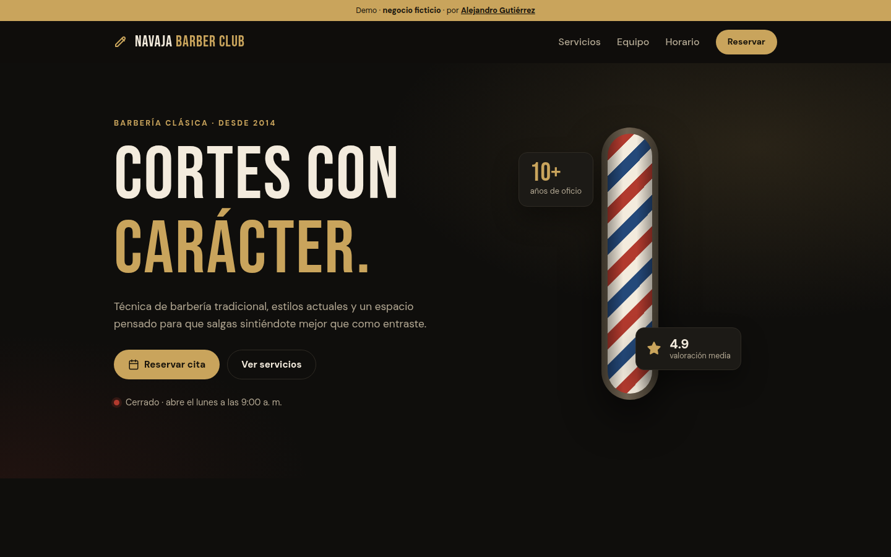
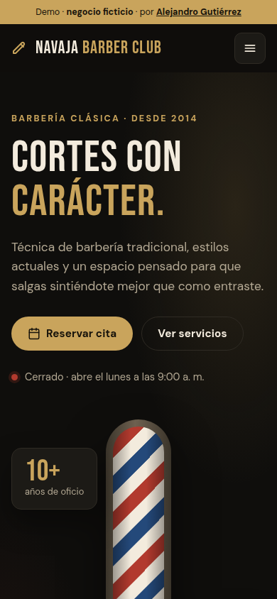

# ✂️ Navaja Barber Club · Landing page

Landing page para una **barbería ficticia**, con catálogo de servicios, equipo, horario en vivo y **reservas en línea** con validación y horas disponibles.

🔗 **Demo:** https://alezzz18.github.io/barberia-landing/

> Proyecto de portafolio. El negocio, los testimonios y la dirección son ficticios, y el formulario no envía datos.

| Escritorio | Móvil |
|---|---|
|  |  |

## ✨ Funcionalidades

- **Contenido generado desde datos:** servicios, precios, equipo, testimonios y horario salen de [`js/data.js`](js/data.js). Para adaptar la landing a otro negocio basta con editar ese archivo.
- **"Abierto ahora" en tiempo real:** calcula si el local está abierto según la zona horaria del negocio (`America/Caracas`) y, si está cerrado, indica cuándo abre.
- **Reservas con horas reales:**
  - Solo muestra horas en las que **cabe el servicio elegido** antes del cierre.
  - Bloquea los días cerrados y las horas ya pasadas (con 30 min de anticipación).
  - Simula horas ocupadas por barbero de forma estable.
  - Valida nombre, teléfono, servicio, fecha y hora con mensajes claros y accesibles.
  - Muestra el total estimado y una confirmación en un `<dialog>` nativo.
- **Identidad de marca propia:** paleta negro carbón, crema y dorado, tipografía *Bebas Neue* + *DM Sans* y un poste de barbería animado solo con CSS.
- **Responsive** (mobile-first), **accesible** (etiquetas, `aria-invalid`, `aria-live`, foco visible) y respeta **"reducir movimiento"**.

## 🧱 Tecnologías

HTML5 · CSS3 (custom properties, grid, animaciones) · JavaScript (ES2020+, sin librerías) · `Intl.DateTimeFormat` para zonas horarias.

Sin dependencias ni paso de compilación.

## 📁 Estructura

```
index.html        Estructura y secciones
css/styles.css    Identidad visual, layout y responsive
js/data.js        Datos del negocio (servicios, horario, equipo…)
js/main.js        Render, horario en vivo, reservas y navegación
assets/           Favicon
docs/             Capturas del README
```

## 🚀 Ejecutar en local

```bash
git clone https://github.com/alezzz18/barberia-landing.git
cd barberia-landing
python3 -m http.server 8080
# abrir http://localhost:8080
```

## 👤 Autor

**Alejandro Gutiérrez** · Desarrollador Full Stack
[Portafolio](https://alezzz18.github.io) · [GitHub](https://github.com/alezzz18)

## 📄 Licencia

[MIT](LICENSE)
